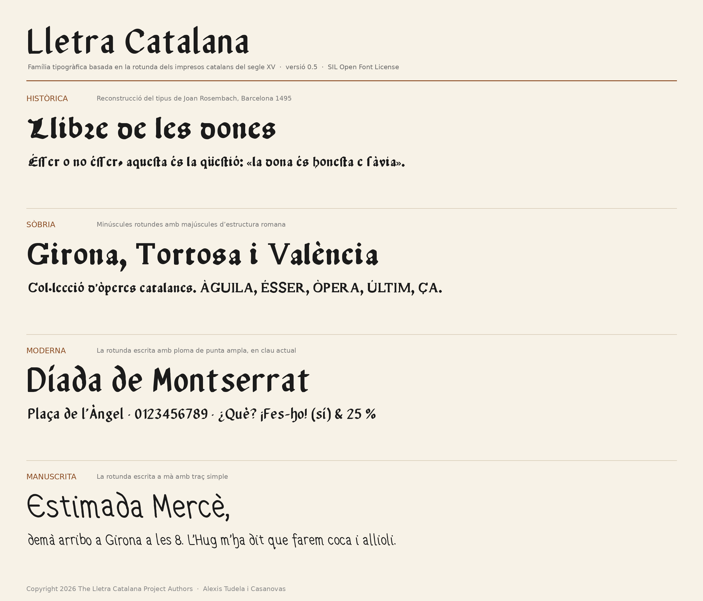

# Lletra Catalana · versió 0.2

Família tipogràfica basada en la lletra gòtica rotunda dels impresos catalans del segle XV.

## Estils
- **Històrica** — reconstrucció del tipus 112 G de Joan Rosembach (*Libre de les dones*, Barcelona 1495), completada amb el Gòtic Incunable de Canibell (1904). Aplica automàticament la s llarga, la r rotunda i les lligadures ſt i ſſ.
- **Sòbria** — les mateixes formes sense substitucions automàtiques, amb C, T i i simplificades.
- **Moderna** — evolució geomètrica de la rotunda, amb els trets catalans exagerats.
- **Manuscrita** — la rotunda escrita a mà amb traç simple, amb tres variants de cada minúscula que s'alternen.

## Funcions OpenType
| Funció | Històrica | Sòbria | Moderna | Manuscrita |
|---|---|---|---|---|
| `calt` (r rotunda, s llarga, alternança) | sí | — | r rotunda | r rotunda + alternança |
| `liga` (ſt, ſſ) | sí | — | — | — |
| `dlig` (abreviatures «que», «per») | sí | ſt, ſſ | sí | sí |
| `hist` (s llarga) | — | sí | sí | sí |
| `ss01` (T i H llegibles) | — | — | sí | — |
| `kern` | sí | sí | sí | sí |

## Fonts històriques
- Rosembach, J. *Libre de les dones*, Barcelona, 1495 (Biblioteca de Catalunya, Bon. 10-VI-34).
- Canibell, E. *Gòtic Incunable*, espècimens de 1904–1905 (*Revista Ibérica de Exlibris*).

## Llicència
Copyright 2026 The Lletra Catalana Project Authors (vegeu AUTHORS.txt).

Aquesta família es distribueix sota la **SIL Open Font License, versió 1.1** (vegeu OFL.txt). Es pot fer servir lliurement, també en usos comercials, i se'n poden fer modificacions i obres derivades, sempre que les fonts no es venguin soles i que les versions modificades es publiquin amb la mateixa llicència.

## Instal·lació
Descarrega els fitxers de la carpeta `fonts/ttf` (recomanat a Windows) o `fonts/otf`, fes-hi clic amb el botó dret i tria «Instal·la».
